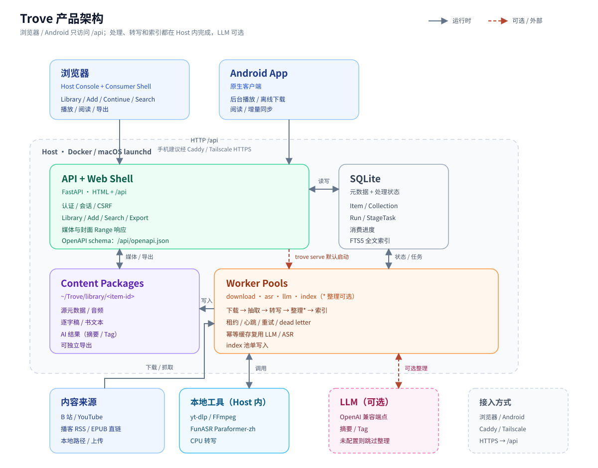
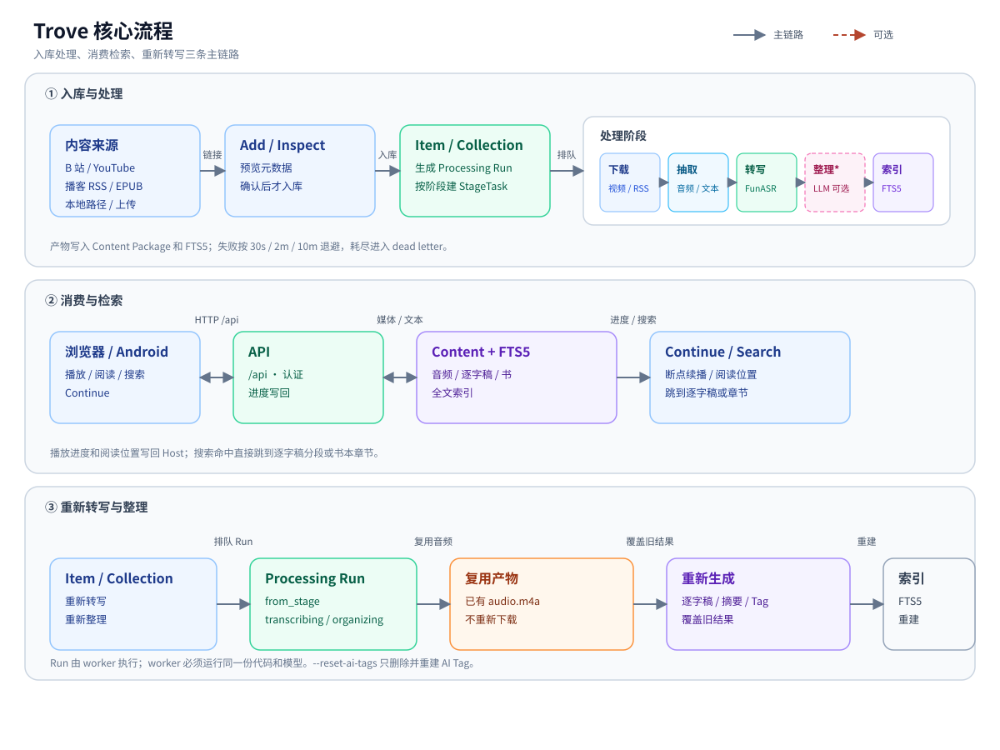

# Trove（拾藏）

Trove 是一个自托管的个人长内容库：把 B 站/YouTube 视频、播客和 EPUB 收进同一个 Library，在自己的 Host（Mac 或 Linux 机器）上完成下载、抽取、转写和整理，再用网页或 Android 客户端收听、阅读和检索。音频是主要消费方式，文本是组织和检索的底稿。

- **统一入库**：B 站 / YouTube 单视频与合集、播客 RSS 单集、EPUB 直链、本地路径和文件上传。
- **本地转写**：FunASR Paraformer-zh + 标点 + VAD，默认 CPU；M1 Pro 参考机上约 7–8 倍实时。
- **可选整理**：OpenAI 兼容 LLM 生成摘要和标签；不配置也能入库、转写、播放和搜索。
- **收听与阅读**：网页播放器支持倍速和断点续播，EPUB 阅读器保存阅读位置，Continue 汇总未完成内容。
- **全文检索**：SQLite FTS5 中文检索，结果定位到逐字稿分段或书本章节。
- **合集**：B 站合集和 YouTube 播放列表按 Collection 批量入库，每集仍是独立 Item。
- **Android 客户端**：原生 App，支持后台播放、离线下载、阅读和增量同步。
- **自托管**：单用户；数据默认在 `~/Trove`；Docker 或 macOS launchd 部署；Library 可导出为可移植 zip。

> 隐私边界：音频和原始文件始终留在 Host。配置 LLM 后，逐字稿和书文本会分块发送给所配置的模型服务；不配置 LLM 时不会外发文本。

## 快速开始

### 1. 前置条件

| 方式 | 依赖 | 说明 |
| --- | --- | --- |
| 原生 macOS | macOS、[uv](https://docs.astral.sh/uv/)、`ffmpeg`/`ffprobe` | 推荐 Apple Silicon；模型和转写都在本机运行。 |
| Docker | Docker、Docker Compose v2 | Linux/macOS 均可；首次启动会下载 ASR 模型。 |
| 客户端 | 浏览器或 Android App | 浏览器访问 `http://127.0.0.1:8765`；Android 见 [docs/android.md](docs/android.md)。 |
| 可选 LLM | OpenAI 兼容 `/chat/completions` | 不配置也能使用除摘要和标签外的全部功能。 |

### 2. 启动 Host

#### Docker（最短路径）

```bash
docker compose up -d --build
docker compose exec api trove auth set-password
open http://127.0.0.1:8765
```

如果 `api` 还没启动，等 `init` 完成后再执行 `docker compose exec`。`init` 服务会先执行数据库迁移；ASR 镜像还会在首次启动时下载约 1.25 GB 的 Paraformer 模型。全新数据目录会在 `trove-data` 卷里生成完整的 `/home/trove/Trove/config.toml`，并把 `host` 设为 `0.0.0.0`。升级已有卷时保留现有配置；如果旧配置没有 `[server]` 段，入口会补上并同样使用 `0.0.0.0`。`api` 默认只发布到 `127.0.0.1:8765`；用 `TROVE_HOST_PORT` 改端口，只在可信反向代理后面才改 `TROVE_PUBLISH_ADDRESS`。

用户配置和数据都在 `trove-data` 卷；密码哈希和 session secret 在应用管理的 `state.toml`，不需要 `.env` 文件。从旧版 `/data` + `trove-config` 布局升级时，`trove-data` 卷根目录会直接变成 `/home/trove/Trove`，旧 `config.toml` 里的密码/session 会自动迁到 `state.toml`；旧 `trove-config` 卷里的 `llm.toml` 不再挂载，需要把 `[llm]` 字段手动合并到新的 `config.toml`。改密码时重新执行 `docker compose exec api trove auth set-password`。要构建不含 ASR 的小镜像：

```bash
TROVE_INSTALL_ASR=false docker compose build
docker compose up -d
```

完整的服务、TLS、备份和升级说明见 [docs/deployment.md#docker-compose](docs/deployment.md#docker-compose)。

#### macOS 原生

```bash
brew install uv ffmpeg
uv sync --extra asr
uv run trove db upgrade
uv run trove auth set-password
uv run trove setup
uv run trove doctor
uv run trove serve
```

`funasr` 是可选依赖组。`trove setup` 首次下载约 1.25 GB 模型（953 MB ASR、292 MB 标点、4 MB VAD），转写只用 CPU，不需要 GPU。没有安装 extra 时转写报 `asr.not_configured`，没有模型时报告 `asr.model_missing` 并提示运行 `trove setup`。基准见 [ADR 0013](docs/adr/0013-paraformer-local-asr.md)。

`trove serve` 默认同时启动处理 worker。要跑两进程部署或单独调试：

```bash
uv run trove serve --no-worker
uv run trove worker
```

数据目录固定为 `~/Trove`。所有运行配置在 `~/Trove/config.toml`；密码哈希和 session secret 在应用管理的 `~/Trove/state.toml`。测试或工具需要临时目录时，用全局 CLI 参数 `trove --home <path>`。

### 3. 验证

```bash
curl -fsS http://127.0.0.1:8765/api/health
uv run trove doctor
```

`/api/health` 返回 200，且 `database.status` 为 `ok`、`worker.status` 为 `ok` 即就绪。`worker.status` 为 `unknown` 或 `stale` 表示 worker 没有运行或心跳过期。Docker 中运行：

```bash
docker compose exec api trove doctor --json
```

### 4. 首次使用

打开 <http://127.0.0.1:8765>，用 `trove auth set-password` 设置的密码登录（Docker 中在容器里执行 `docker compose exec api trove auth set-password`）。

1. **Add**：粘贴链接、填本地绝对路径，或上传文件。
2. **Library**：查看处理状态；正在处理或失败的内容在 Inbox 中，逐字稿和元数据在详情页。
3. **Continue / Search**：继续上次收听或阅读；搜索标题、摘要、逐字稿、书文本和 Tag。
4. **可选**：配置 [LLM](#llm-配置) 后，新内容会生成摘要和 Tag；已有内容可在详情页重新整理。

## 产品架构

[](docs/assets/architecture.svg)

Trove 是单租户自托管应用：浏览器和 Android 只访问 Host 的 `/api`；API/Web Shell、Worker、SQLite 和内容包都在 Host 内，yt-dlp/FFmpeg/FunASR 在本机运行，LLM 是可选外部依赖。内容包是逐字稿和书文本的事实来源，SQLite 保存元数据、处理状态和 FTS5 索引。

## 核心流程

[](docs/assets/flows.svg)

每个 Item 的一次处理是一条 Processing Run；Run 下面按阶段生成 StageTask。可重试错误按 30 秒、2 分钟、10 分钟退避；永久错误立即失败；重试耗尽后进入 dead letter，等待手动重试。worker 用租约和心跳恢复崩溃任务；已完成的外部调用通过幂等缓存复用，不会重复调用 LLM 或 ASR。

消费侧，Continue 按最近消费排序，Android 通过增量同步共享进度；合集本身不可消费，状态由单集派生。

## 使用

### 添加内容

| 来源 | 入口 | 行为 |
| --- | --- | --- |
| B 站 / YouTube 单视频 | Add → 链接 | 只接受平台白名单；先读取元数据，确认后才入库。 |
| B 站合集 / YouTube 播放列表 | Add → 链接 | 生成 Collection，每个单集独立处理。 |
| 播客 RSS | Add → 链接 | 识别 feed 后选择一集入库。 |
| EPUB 直链 | Add → 链接 | 下载 EPUB 后抽取文本。 |
| 本地音视频 / EPUB | Add → 本地路径 | 填 Host 上的绝对路径；音频和 EPUB 复制进库，视频只保留路径和抽取的音频。 |
| 上传文件 | Add → 上传文件 | 默认上限：视频 4 GB、音频 500 MB、EPUB 100 MB。 |

### 收听与阅读

- 网页播放器支持播放/暂停、拖动进度、倍速和迷你播放器；支持的浏览器会接入系统 Media Session。
- 收听页包含带时间戳的逐字稿，可在逐字稿内搜索；阅读页按章节分页并保存滚动位置。
- 详情页可以导出单个 Item；Library 支持多选后导出 zip。

### 重新转写与整理

已有 Item 会保留原来的逐字稿，直到你主动排队新的处理 Run。重新转写复用已有的 `audio.m4a`，不会重新下载或抽取音频。

单个 Item：在 Item 页点击 **重新转写（不重新下载）**，或调用 `POST /api/items/<item_id>/reprocess`，请求体为 `{"from_stage": "transcribing"}`。

整个合集：

```bash
uv run trove collection reprocess <collection_id> --from-stage transcribing
```

`--from-stage organizing` 只重新生成摘要和 Tag，不重新转写；`--reset-ai-tags` 会先删除合集的 AI Tag 再排队，用户手动添加的 Tag 保留。Run 由 worker 执行，所以 worker 必须运行同一份代码和模型；不要对同一个 `~/Trove` 同时运行两个 worker。

重新转写会覆盖旧逐字稿；想保留就先把 `~/Trove/library/<item_id>/transcript.json` 复制到别处。没有配置 LLM 时，新逐字稿仍会写入和索引，但 `organizing` 会失败；配置后重试 Item 即可。M1 Pro 参考机上单路转写约占用 2.8 GB 峰值内存和一个 CPU 核心。

### Android 客户端

**首次使用**：写入本机 Android SDK 路径（gitignored）：

```bash
scripts/android/sdk-properties.sh
```

**真机调试**：确保真实 Host 在 `http://127.0.0.1:8765` 运行（例如另一个终端执行 `uv run trove serve`），手机通过 USB 连接后运行：

```bash
scripts/android/use-real-host.sh
```

脚本会构建并安装 `prodDebug`、设置 `adb reverse` 到 `http://127.0.0.1:8765` 并启动 App；`--no-build`、`--clear-data`、`--port` 见脚本 `--help`。需要局域网明文调试时用 `lanDebug`。Release 包拒绝明文 HTTP，需要 Caddy/Tailscale 提供的 HTTPS。签名、Caddy 根证书、OEM 后台限制和真机验收步骤见 [docs/android.md](docs/android.md)。

## 配置

所有运行配置都在 `~/Trove/config.toml`，不再读取 `TROVE_*` 配置环境变量。密码哈希和 session secret 属于应用状态，写在 `~/Trove/state.toml`；两个文件都由 Trove 以 `0600` 管理。Docker Compose 的部署变量（`TROVE_HOST_PORT`、`TROVE_PUBLISH_ADDRESS`、`TROVE_IMAGE_TAG`、`TROVE_INSTALL_ASR`）不属于应用配置，仍由 compose 使用。

### 目录

| 路径 | 内容 |
| --- | --- |
| `~/Trove/` | 数据目录：`trove.db`、`library/`、`logs/`、`cache/`、`backups/`、`config.toml`、`state.toml`。Docker 中为 `/home/trove/Trove`。 |
| `~/Trove/library/<item-id>/` | 内容包：源元数据、音频、逐字稿、书文件和 AI 结果。 |
| `~/Trove/logs/` | 应用日志（10 MB 轮转，保留 5 份）和 `runs/<run-id>.log`。 |
| `~/Trove/config.toml` | 用户配置：server、limits、worker、ASR、LLM。 |
| `~/Trove/state.toml` | 应用管理：密码哈希、session secret、session epoch；不要手动编辑。 |

### config.toml

全新数据目录会在首次启动时生成完整的 `config.toml`；已有配置文件不会被覆盖，缺失的 section 使用代码默认值。也可以运行 `uv run trove config init` 创建配置文件（已有配置会保留，只补齐缺失的 `[server]`）。Docker 入口在每次启动时确保 `[server]` 存在；旧配置缺少该段时会补上 `host = "0.0.0.0"`。修改后重启 API 和 worker。

Docker 中编辑数据卷里的配置：

```bash
docker compose cp api:/home/trove/Trove/config.toml ./trove-config.toml
chmod 600 ./trove-config.toml
${EDITOR:-vi} ./trove-config.toml
docker compose exec -T api sh -c 'umask 077; cat > /home/trove/Trove/config.toml' < ./trove-config.toml
docker compose restart api worker
```

写回时在容器内以 `trove` 用户覆盖文件，避免 `docker compose cp` 把宿主 UID/GID 带进数据卷。若已经用 `docker compose cp` 写回并看到 `Could not read config ... Permission denied`，先用 root 修复属主再重启：

```bash
docker compose run --rm --user root --entrypoint chown init trove:trove /home/trove/Trove/config.toml
docker compose restart api worker
```

示例：

```toml
[server]
host = "127.0.0.1"        # Docker 首次启动会写成 0.0.0.0
port = 8765
secure_cookies = false
log_console = true

[limits]
max_video_bytes = 4294967296
max_audio_bytes = 524288000
max_epub_bytes = 104857600
max_feed_bytes = 10485760
max_podcast_bytes = 1073741824
max_collection_items = 100
max_collection_duration_sec = 360000

[asr]
model = "paraformer-zh"

[worker]
pools = ["all"]           # 或 ["download", "asr", ...]
lease_seconds = 25
heartbeat_seconds = 5
reaper_interval_seconds = 5
shutdown_timeout_seconds = 30

[worker.concurrency]
download = 3
asr = 1
llm = 2
index = 1                 # index 固定单写入

[worker.stage_max_attempts]
downloading = 3
extracting_audio = 3
extracting_text = 3
transcribing = 1
organizing = 3
indexing = 2

[intake]
ytdlp_cookies = ""        # 相对路径按 ~/Trove 解析

[llm]
enabled = false
# 启用时填写：
model = ""
base_url = ""
api_key = ""
```

`pools` 是数组；`[worker.concurrency]` 的 `index` 总是被压到 1。阶段默认尝试次数：下载、抽取和整理各 3 次，转写 1 次，索引 2 次。租约必须大于心跳。完整规则见 [docs/deployment.md#worker-leases-retries-and-dead-letters](docs/deployment.md#worker-leases-retries-and-dead-letters)。

### LLM 配置

LLM 配置在同一个 `config.toml` 的 `[llm]` 表。新配置模板默认 `enabled = false`，整理阶段会跳过；把 `enabled` 设为 `true` 并填写 `model`、`base_url`、非空 `api_key` 后生效。文件在启动时读取，修改后重启 API 和 worker。

```toml
[llm]
enabled = true
model = "deepseek-flash"
base_url = "https://api.deepseek.com/v1"
api_key = "sk-your-key"
```

任何 OpenAI 兼容端点都可以。Docker 中访问宿主机 Ollama 时，`base_url` 用容器可达地址：

```toml
[llm]
enabled = true
model = "qwen3.5:4b"
base_url = "http://host.docker.internal:11434/v1"
api_key = "ollama"
```

| 字段 | 默认值 | 说明 |
| --- | --- | --- |
| `model` | 必填 | 模型名。 |
| `base_url` | 必填 | OpenAI 兼容 API 的 base URL。 |
| `api_key` | 空（必填） | 提供商密钥；本地无鉴权服务也必须填一个非空占位值。 |
| `enabled` | `false`（新配置模板） | 设为 `false` 跳过整理。 |
| `chunk_chars` | 20000 | 每次送进模型的最大字符数。 |
| `max_calls_per_item` | 16 | 单个 Item 的最大模型调用次数。 |
| `max_output_tokens_per_call` | 1024 | 单次调用的输出 token 上限。 |
| `max_input_tokens_per_item` | 200000 | 单个 Item 的输入 token 上限。 |
| `input_cost_per_million` | 0.28 | 输入成本估算，每百万 token。 |
| `output_cost_per_million` | 0.42 | 输出成本估算，每百万 token。 |
| `timeout_seconds` | 90 | 单次模型请求超时。 |

整理始终请求 `response_format = {"type": "json_object"}` 和 `reasoning_effort = "none"`，让思考型模型直接返回最终 JSON。旧版 `~/.config/trove/llm.toml` 会在首次加载时自动导入到 `config.toml`；`llm_api_key` 文件不再读取。

没有配置 LLM 时，处理仍会保留音频和逐字稿，`organizing` 阶段跳过。逐字稿和书文本会分块发送给配置的 LLM，音频和源文件不会离开 Host。

## 运维

### 健康检查与日志

| 目的 | 命令 |
| --- | --- |
| 依赖与布局自检 | `uv run trove doctor` 或 `uv run trove doctor --json` |
| API 健康 | `curl -fsS http://127.0.0.1:8765/api/health` |
| 应用日志 | `tail -f ~/Trove/logs/trove.log` |
| 单次 Run 日志 | `tail -f ~/Trove/logs/runs/<run-id>.log` |
| 指标 | `curl -H "Authorization: Bearer <token>" http://127.0.0.1:8765/metrics` |
| Docker 状态 | `docker compose ps` |
| Docker 日志 | `docker compose logs -f --tail=200 api worker` |

`trove doctor` 会检查 FFmpeg/ffprobe、yt-dlp、SQLite FTS5、数据目录权限、数据库版本、登录密码、ASR 模型和监听端口；可以随时重复运行。

### macOS launchd

```bash
scripts/install-launchd.sh
launchctl print gui/$(id -u)/com.trove.api
launchctl print gui/$(id -u)/com.trove.worker
```

两个 agent 都会在登录时启动并在崩溃后自动重启。数据目录默认 `~/Trove`；日志在 `~/Trove/logs/com.trove.*.log`。要拆分资源池：

```bash
uv run trove service install --pool all --pool asr
```

卸载只移除 plist 并停止 agent，不删除 `~/Trove`：

```bash
scripts/uninstall-launchd.sh
```

HTTPS（Caddy 内部 CA 或 Tailscale）、开机自启和更多 launchd 细节见 [docs/deployment.md](docs/deployment.md)。

### Docker 服务与 worker 池

| 服务 | 作用 |
| --- | --- |
| `init` | 执行迁移；ASR 镜像还会下载模型。 |
| `api` | HTTP API 和网页，默认发布到 `127.0.0.1:8765`。 |
| `worker` | 默认 `all` 池。 |
| `worker-download` / `worker-asr` / `worker-llm` / `worker-index` | `pools` profile 中的拆分池。 |
| `caddy` | 可选的 TLS 终止（`caddy` profile）。 |

拆分池前先停掉默认 worker，否则两个进程会争抢任务：

```bash
docker compose stop worker
docker compose --profile pools up -d \
  worker-download worker-asr worker-llm worker-index
```

`index` 池必须保持单写入；不要同时运行多个包含 `indexing` 的 worker 进程。

### 备份与恢复

```bash
# SQLite 在线备份，Host 运行中也可以执行。
mkdir -p "$HOME/Trove-backup"
sqlite3 ~/Trove/trove.db ".backup '$HOME/Trove-backup/trove-$(date +%F).db'"

# 内容包、逐字稿、书和 AI 结果。
rsync -a --delete ~/Trove/library/ ~/Trove-backup/library/

# 用户配置和应用密钥（0600；包含 LLM key 和密码哈希）。
rsync -a ~/Trove/config.toml ~/Trove/state.toml ~/Trove-backup/

# 通过 UI 或 API 做一次 zip 导出。
curl -OJ -b cookies.txt http://127.0.0.1:8765/api/export
```

`trove db upgrade` 在迁移前会自动写一份 SQLite 备份到 `~/Trove/backups/`，保留最新 5 份。恢复时先停止 API 和 worker，替换数据库并删除旧的 `trove.db-wal`、`trove.db-shm`；完整回滚步骤见 [docs/deployment.md#upgrade-backup-and-rollback](docs/deployment.md#upgrade-backup-and-rollback)。

### 升级

```bash
# 原生
git pull
uv sync --locked --extra asr
uv run trove db upgrade
uv run trove doctor
launchctl kickstart -k gui/$(id -u)/com.trove.api
launchctl kickstart -k gui/$(id -u)/com.trove.worker
```

```bash
# Docker；init 会执行迁移
git pull
TROVE_IMAGE_TAG="$(uv run trove --version | cut -d' ' -f2)" docker compose build
docker compose up -d
docker compose exec api trove doctor
```

迁移通常只能向前；升级前保留数据库和内容包备份。

### Android 设备与同步

```bash
uv run trove device list
uv run trove device revoke <device-id>
```

撤销在下一次请求生效；修改 Host 密码会让所有设备 token 失效。恢复旧数据库备份后，轮换同步 epoch 让客户端丢弃旧游标并全量同步：

```bash
uv run trove sync reset-epoch
```

### 安全

默认只绑定 `127.0.0.1`。手机访问请用 Caddy HTTPS 或 Tailscale，不要在日常使用中直接 `--lan` 明文暴露。登录使用 Argon2id 密码哈希，Cookie 带 HttpOnly/SameSite，页面启用 CSP，Android 使用可撤销的设备 token。完整回归清单见 [docs/security.md](docs/security.md)。

## 常见问题

| 现象 | 检查与处理 |
| --- | --- |
| 转写报 `asr.not_configured` | 安装 ASR extra：`uv sync --extra asr`，然后重启 API 和 worker。 |
| 转写报 `asr.model_missing` | 运行 `uv run trove setup` 下载模型。 |
| 整理报 `llm.not_configured` | 检查 `~/Trove/config.toml` 的 `[llm]`：`enabled = true`，并填好 `model`、`base_url`、`api_key`；重启进程后重试 Item。 |
| 页面提示处理服务未运行 | 启动 `uv run trove worker`，或用默认的 `uv run trove serve`；Docker 中检查 `worker` 服务。 |
| 端口被占用 | 改 `~/Trove/config.toml` 的 `[server] port`；Docker 中还要同步 `TROVE_HOST_PORT` 和客户端地址。 |
| 手机打不开 Host | 确认地址和端口；Docker 默认只发布到 loopback，需要 Caddy/Tailscale 或显式改发布地址。 |
| 搜索没有结果 | 运行 `uv run trove index status` 查看覆盖；必要时 `uv run trove index rebuild`。 |
| 重新转写提示音频缺失 | 音频产物已不存在，重新入库该 Item。 |
| 合集重处理没有执行 | worker 没运行，或 worker 仍在跑旧代码/旧模型；重启后再排队。 |
| 标签越来越多 | 用 `uv run trove collection reprocess <id> --reset-ai-tags` 重建该合集的 AI Tag。 |
| Android release 无法连接 | release 拒绝明文 HTTP；配置 Caddy/Tailscale HTTPS，并按 [docs/android.md](docs/android.md) 安装证书。 |

## 开发与测试

```bash
./scripts/check.sh --fast   # ruff + mypy + import-linter + 非浏览器/FFmpeg/网络测试
./scripts/check.sh --full   # 完整 pytest + 浏览器测试 + 文档检查
```

`--fast` 是 CI 使用的模式；`--full` 需要 Host 上有 `ffmpeg`/`ffprobe`，并需要 Playwright 的 Chromium：`uv run playwright install chromium`。两种模式都跳过网络测试，需要时显式运行 `uv run pytest -m network`。测试默认用 4 个 xdist worker，设置 `PYTEST_WORKERS=0` 可串行执行。文档的表格和相对链接由 `python3 scripts/check-docs.py` 检查。

层级依赖由 import-linter 强制：`domain` 不依赖 `services`、`adapters`、`web`、`db`；`services` 不依赖 `web`、`adapters`；`adapters` 不依赖 `services`、`web`。改动位置见 [docs/agents/code-map.md](docs/agents/code-map.md)。

| 场景 | 命令 |
| --- | --- |
| Docker 冒烟测试 | `scripts/docker-smoke.sh` |
| Android SDK 初始化 | `scripts/android/sdk-properties.sh` |
| Android 构建与测试 | `scripts/android/check.sh` |
| Android 真机调试（真实 Host） | `scripts/android/use-real-host.sh` |
| Android 设备检查 | `scripts/android/device-check.sh` |
| Android 验收 Host（临时数据） | `scripts/android/acceptance-host.sh` |
| Android release 检查 | `scripts/android/release-check.sh` |
| 发布前只读检查 | `scripts/release-check.sh` |
| 搜索索引覆盖 | `uv run trove index status --json` |
| 重建搜索索引 | `uv run trove index rebuild` |
| 终端搜索 | `uv run trove search "道德经" --json` |

## 文档

| 文档 | 内容 |
| --- | --- |
| [docs/deployment.md](docs/deployment.md) | Docker、launchd、Caddy/Tailscale、worker 池、升级、备份与卸载。 |
| [docs/android.md](docs/android.md) | Android 构建、签名、证书和真机验收。 |
| [docs/api-contract.md](docs/api-contract.md) | `/api` v1 兼容性、错误格式、请求 ID 和同步契约。 |
| [docs/security.md](docs/security.md) | 安全回归清单与残余风险。 |
| [docs/observability.md](docs/observability.md) | Prometheus 指标、OpenTelemetry trace、Grafana dashboard。 |
| [docs/licenses.md](docs/licenses.md) | 依赖许可证。 |
| [GLOSSARY.md](GLOSSARY.md) | Item、Collection、Processing Run 等领域术语。 |
| [docs/adr/](docs/adr/) | 架构决策记录。 |
